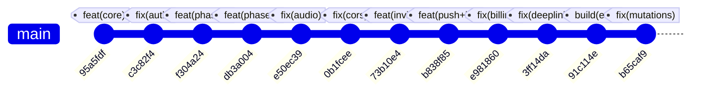

# Engineering Learning Log — Rota Monorepo

This document captures the verified architectural decisions, technical challenges, debugging histories, and engineering lessons across the development of the Rota application. All entries are backed by verifiable Git commit history, tests, and documentation artifacts.

> [!NOTE]
> Technical milestones and decisions in Sections 1–4 are derived from verifiable Git commits, test suites, and documentation. Section 5 contains the developer's authentic personal reflections on their engineering journey.

---

## 1. Timeline of Engineering Milestones & Git History



| Commit | Date / Phase | Scope | Description & Verifiable Impact |
|---|---|---|---|
| [`95a5fdf`](https://github.com/ScrappyAT/rota/commit/95a5fdf) | Phase 1 & 2 | Foundation & RBAC | Established npm workspaces, Express API, PostgreSQL migrations 001–002, Redis, JWT/refresh auth, and `requireRole` middleware. |
| [`c3c82f4`](https://github.com/ScrappyAT/rota/commit/c3c82f4) | Phase 2 | Auth Hardening | Refresh token reuse detection (family revocation), last-owner demotion protection, and manager permission bounds. |
| [`f304a24`](https://github.com/ScrappyAT/rota/commit/f304a24) | Phase 3 | Scheduling & Activity | Migration 003, shifts, assignments, swaps, activity feed, keyset cursor pagination, and deterministic 10k seed script. |
| [`db3a004`](https://github.com/ScrappyAT/rota/commit/db3a004) | Phase 4 | Billing & Deployment | Migration 004, plan catalog, integer minor-unit proration engine, Flutterwave client, Dockerfile, and Railway packaging. |
| [`e50ec39`](https://github.com/ScrappyAT/rota/commit/e50ec39) | Phase 4+ | Push Polish | Android notification channel sound configuration using default system chime. |
| [`0b1fcee`](https://github.com/ScrappyAT/rota/commit/0b1fcee) | Phase 4+ | Web & CORS | Express CORS allow-list for `http://localhost:8081` (Expo web), preflight OPTIONS handler for credentialed endpoints. |
| [`73b10e4`](https://github.com/ScrappyAT/rota/commit/73b10e4) | Phase 4+ | Invitations | 6-digit numeric invitation codes (`crypto.randomInt`), SHA-256 backend hashing, 15-minute expiry, and attempt rate-limiting. |
| [`b838f85`](https://github.com/ScrappyAT/rota/commit/b838f85) | Phase 4+ | Push & Performance | Migration 005, Expo push delivery, mobile registration, k6 load testing (60 VUs, 0% errors, p95 62.7ms). |
| [`e981860`](https://github.com/ScrappyAT/rota/commit/e981860) | Phase 4+ | Billing Hardening | Minor unit (kobo) to naira pricing fixes, seat limits display, browser dismissal resilience during payment checkout. |
| [`3ff14da`](https://github.com/ScrappyAT/rota/commit/3ff14da) | Phase 4+ | Deep Links & Ledger | Expo Router deep-link route for `billing/redirect`, non-destructive pending payment ledger reconciliation. |
| [`91c114e`](https://github.com/ScrappyAT/rota/commit/91c114e) | Phase 4+ | EAS Build Pipeline | Fixed EAS cloud build failure: added `eas-build-post-install` to build `@rota/shared` in clean container environments. |
| [`b65caf9`](https://github.com/ScrappyAT/rota/commit/b65caf9) | Phase 4+ | Mobile UX Polish | Fixed false "Request failed" alerts on shift deletion and swap approval; separated `dataOrThrow` from `ensureSuccess` for 204 responses. |

---

## 2. Key Engineering Decisions & Rationale

### 2.1 Multi-Tenant Role-Based Access Control (RBAC)
- **Decision**: Store roles exclusively per team in `team_memberships.role` (`OWNER`, `MANAGER`, `STAFF`) with deliberately **no global role** on the `users` table.
- **Rationale**: Small businesses operate independently. A user might be an `OWNER` of their own cafe while being `STAFF` at a medical clinic. Global roles would violate tenant isolation boundaries.
- **Enforcement**: Centralized `requireRole([...allowedRoles])` middleware ([`apps/api/src/middleware/role.ts`](file:///c:/Users/HP/Desktop/rota%20project/apps/api/src/middleware/role.ts)). Non-members receive HTTP 404 to avoid leaking tenant existence; insufficient roles receive HTTP 403.

### 2.2 Keyset Cursor Pagination Over Offset Pagination
- **Decision**: Implement keyset cursor pagination over a stable descending tuple `(starts_at|created_at, id)` ([`apps/api/src/pagination.ts`](file:///c:/Users/HP/Desktop/rota%20project/apps/api/src/pagination.ts), [`docs/PAGINATION.md`](file:///c:/Users/HP/Desktop/rota%20project/docs/PAGINATION.md)).
- **Rationale**: Traditional `OFFSET / LIMIT` pagination suffers from:
  1. $O(N)$ query degradation as offsets grow large because the database must scan and discard $N$ rows.
  2. Page-drift / duplicate rows when items are inserted or deleted while a client is paginating.
- **Verification**: Tested against a 10,000-row activity dataset under k6 load (`p95 = 24.45 ms` across 3,200 continuous pagination requests with 0 duplicate or skipped records).

### 2.3 Strict Minor-Unit (Integer) Money Model
- **Decision**: All subscription prices, seat additions, proration calculations, and invoice balances are calculated and stored strictly in integer minor units (kobo for NGN) ([`apps/api/src/billing/proration.ts`](file:///c:/Users/HP/Desktop/rota%20project/apps/api/src/billing/proration.ts)).
- **Rationale**: Floating-point arithmetic introduces rounding inaccuracies (e.g., `0.1 + 0.2 !== 0.3`). The gateway client converts from kobo to naira only at the boundary when communicating with Flutterwave.
- **Verification**: 26 unit tests in [`apps/api/__tests__/billing.test.ts`](file:///c:/Users/HP/Desktop/rota%20project/apps/api/__tests__/billing.test.ts) verify exact zero-loss penny rounding on partial-month upgrades and seat changes.

### 2.4 Dual-Tier State Architecture for Mobile (TanStack Query + Disk Cache)
- **Decision**: Combine in-memory TanStack React Query v5 caching with disk-persisted file caching via [`apps/mobile/src/storage/shiftCache.ts`](file:///c:/Users/HP/Desktop/rota%20project/apps/mobile/src/storage/shiftCache.ts).
- **Rationale**: Shift workers frequently check schedules in basements, breakrooms, or areas with poor cellular reception. Persisting shift lists and individual shift details by `userId:teamId` guarantees instant offline rendering while blocking conflicting writes until reconnected.

---

## 3. Notable Technical Challenges & Applied Fixes

### 3.1 Challenge: Refresh Token Reuse & Session Hijacking
- **Problem**: In basic JWT refresh flows, if a stolen refresh token is reused after rotation, an attacker can maintain persistent access.
- **Solution (Commit `c3c82f4`)**: Implemented token family reuse detection in [`apps/api/src/routes/auth.ts`](file:///c:/Users/HP/Desktop/rota%20project/apps/api/src/routes/auth.ts). Refresh tokens are stored as bcrypt hashes. Presenting an already-rotated token triggers immediate revocation of **all** active refresh tokens belonging to that user family, forcing re-authentication.

### 3.2 Challenge: Mobile Invitation Usability
- **Problem**: The original invitation system generated 64-character hexadecimal tokens that were virtually impossible for users to manually type into mobile screens.
- **Solution (Commit `73b10e4`)**: Created a 6-digit cryptographically secure numeric invitation code system using Node.js `crypto.randomInt(0, 1000000)` with `padStart(6, '0')`.
- **Security Hardening**:
  - Raw codes are never stored in the database; only SHA-256 hashes are persisted (`invitations.token_hash`).
  - Codes expire after 15 minutes.
  - Brute-force protection: Failed redemption attempts are tracked in `invitation_attempts` (`006_invitation_attempts.sql`), blocking submissions after 5 consecutive failed guesses.

### 3.3 Challenge: EAS Cloud Monorepo Build Failure
- **Problem (Build ID `631e12c8-c4a8-42d1-a07a-a16bf5ce25a8`)**: Standalone Android preview builds on Expo Application Services (EAS) failed during Metro bundling with:
  `Unable to resolve module @rota/shared from apps/mobile/app/teams/invite.tsx`.
- **Root Cause**: In clean cloud build containers, `npm install` runs, but `@rota/shared` had not been compiled to JavaScript (`packages/shared/dist/index.js` was missing).
- **Solution (Commit `91c114e`)**: Added an `eas-build-post-install` lifecycle script to root `package.json`:
  ```json
  "eas-build-post-install": "npm run build -w @rota/shared"
  ```
  This guarantees that shared TypeScript schemas and types are compiled into `dist/` before Metro bundling commences.

### 3.4 Challenge: False "Request Failed" Alerts on Successful Mutations
- **Problem**: On physical Samsung Android test builds, deleting a shift or approving a swap succeeded on the backend and updated the database, but the app popped up an alert: `"Error — Request failed"`.
- **Root Cause**:
  1. [`apps/mobile/src/api/ensure.ts`](file:///c:/Users/HP/Desktop/rota%20project/apps/mobile/src/api/ensure.ts) used `dataOrThrow<T>`, which threw an `ApiError` if `res.data` was `undefined`. Delete endpoints and swap actions return HTTP 204 No Content or `{ success: true }` without a `data` field.
  2. TanStack Query refetched the deleted shift (`['shift', teamId, shiftId]`) upon screen unmount, hitting a 404.
- **Solution (Commit `b65caf9`)**:
  - Implemented `ensureSuccess(res)` to validate `res.success === true` without requiring a payload.
  - Updated [`apps/mobile/src/api/client.ts`](file:///c:/Users/HP/Desktop/rota%20project/apps/mobile/src/api/client.ts) to parse HTTP 204/205 responses into `{ success: true }`.
  - Added explicit query eviction before navigating away: `queryClient.removeQueries({ queryKey: ['shift', teamId, shiftId] })`.
  - Added regression test suite in [`apps/api/__tests__/mutationResponseContract.test.ts`](file:///c:/Users/HP/Desktop/rota%20project/apps/api/__tests__/mutationResponseContract.test.ts).

### 3.5 Challenge: Hosted Checkout Deep-Link Routing & Stale Pending Payments
- **Problem**: Returning to Android from Flutterwave checkout redirected to `rota://billing/redirect`, triggering Expo Router's "Oops! This screen doesn't exist" route, leaving behind stale pending payment cards in the UI.
- **Solution (Commit `3ff14da`, `e981860`)**:
  - Registered the redirect route in Expo Router (`apps/mobile/app/billing/redirect.tsx`).
  - Hardened [`apps/mobile/src/utils/checkout.ts`](file:///c:/Users/HP/Desktop/rota%20project/apps/mobile/src/utils/checkout.ts) to verify specific transaction IDs rather than assuming missing pending payments equal success.
  - Implemented safe pending payment reconciliation in [`apps/api/src/billing/service.ts`](file:///c:/Users/HP/Desktop/rota%20project/apps/api/src/billing/service.ts) to keep obsolete cards out of the UI without mutating ledger entries that the gateway might still settle.

---

## 4. Engineering Lessons Learned (Verifiable)

1. **Strict Types Across Workspaces Save Production Debugging**: Defining shared Zod schemas in `packages/shared` enforced identical input validation contracts between the Express API and React Native forms, preventing schema desynchronization.
2. **Deterministic Large Data Seeds are Indispensable**: Testing keyset cursor pagination with 10 rows masked timestamp collision bugs. Seeding 10,000 rows with intentional timestamp bucketing (`index/3` collisions) forced the implementation of strict `(created_at, id)` composite tie-breakers.
3. **HTTP 204 Contracts Must be Explicit on Mobile**: In REST APIs, `204 No Content` is standard for deletes and void actions. Mobile client abstractions must treat 204 as a successful outcome without attempting `response.json()` or expecting data properties.
4. **Cloud Build Environments Expose Missing Build Steps**: Code that works locally because of pre-existing `dist/` folders will immediately fail in clean CI/EAS environments unless workspace compilation hooks (`eas-build-post-install`) are explicitly configured.

---

## 5. Developer Self-Reflection & Evaluation

### 5.1 What I'm Most Proud Of
Getting Rota to work as a standalone application on my actual Android phone was my biggest achievement on this project. It is one thing to see code running in a local browser or emulator, but seeing something I built running on a real physical device was really rewarding.

### 5.2 Biggest Challenge
Setting up the backend and deploying it on Railway was definitely the hardest part. Getting all the pieces—the Express API, PostgreSQL database, and Redis cache—connected and working together reliably took a lot of effort and trial and error.

### 5.3 Biggest Learning
My biggest learning takeaway was understanding how the frontend communicates with the backend. Going through this project helped me clearly see how HTTP requests and responses work in practice, how data passes back and forth, and how the client handles server responses.

### 5.4 What I Would Do Differently
If I were to start this project over from the beginning, I would spend more time planning out the backend before starting development. Having a clearer plan for the endpoints, data flow, and services upfront would have saved time later on.

### 5.5 How I've Grown
Completing this project helped me grow as a developer. I feel much more confident tackling technical problems and building applications that people can actually use.
