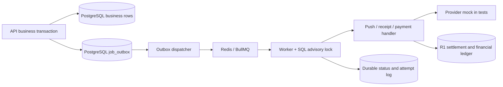

# Milestone R2 implementation report

Date: 2026-11-02. Repository: `C:/Users/HP/Desktop/rota project`.
Branch: `codex/r2-durable-jobs-settings`, created from synchronized `origin/main`
at `bd149a2827e7ea67e7f27647f37908ad3481ef5d` (R1 merge PR #1).
R2 changes remain uncommitted for review. No push, feature merge, deployment,
production migration, real payment or actual push notification was performed.
R3 and R4 were not started. The authoritative source is the original Final
Graduation Task PDF, Part 2 Task A, especially pages 16, 19 and 20.

## 1. Requirement mapping

| R2 scope | Implementation and evidence |
|---|---|
| Transactional outbox | Migration 008; `services/outbox.ts:enqueueOutbox`; `services/activity.ts:addActivity`; shift/swap notification writes use the business transaction client before COMMIT; `billing/initiation.ts:initiateBilling` stores initialization and reconciliation intents with the R1 idempotency/payment records |
| Redis/BullMQ workers | `services/job-runtime.ts:createJobQueue/dispatchOutbox/startJobWorker/processOutboxJob`; `services/job-handlers.ts:handleOutbox`; separately runnable `worker.ts`; no push/provider call remains in a request handler |
| Retries, failed tracking and restart recovery | Bounded BullMQ exponential retries, SQL status/attempt logs, Redis publication backoff, deterministic job ID/generation, session advisory lock, interrupted-attempt tracking, operator `replayDeadJob`; real Redis and killed child-worker tests |
| Preserve R1 financial integrity | R1 proration/ledger modules and migrations 001-007 unchanged; existing billing tests execute worker/poll flow; original money/currency/revision/late-payment assertions retained; both pre-R1 and pre-R2 upgrade preservation tests |
| Ambiguous initialization | Durable QUEUED -> CLAIMED initialization fence; CLAIMED/AMBIGUOUS never POST again; read-only `verifyTransactionByReference`; bounded retry -> MANUAL_REVIEW while payment stays PENDING for a later valid webhook |
| Server settings | `services/settings.ts:readSettings/writeSettings`, strict shared schemas, `/settings` GET/PATCH; quiet hours, IANA zone, categories, legacy fine-grained toggles, language, theme and per-field server timestamps |
| Device synchronization/conflicts | Actual shared `SettingsController`, mobile `SettingsProvider` login/foreground refresh, optimistic updates/rollback, stale-read and disposed-user protection; server field-level receive-time LWW |
| Quiet hours | `quiet-hours.ts:nextPermittedDelivery`, `push-delivery.ts:deliverPush`; checked before delivery and each individual device send; SQL rescheduling plus BullMQ delayed work; DST/offset and preference-change tests |
| Correct deep links | Actual shared `notificationTarget`; validate membership, select team, then route with explicit team ID; exact swap-detail API/screen; server team ID overrides arbitrary notification data |
| Focused automated tests | `r2-jobs.integration.test.ts`, `settings.integration.test.ts`, `quietHours.test.ts`, `settingsController.test.ts`, `r2Migration.test.ts`; updated billing/push/adapter regressions; final results below |

Backend behavior is exercised against actual isolated PostgreSQL and Redis.
The shared mobile coordinator and destination resolver are directly unit-tested;
mobile UI, OS foreground events and device navigation have not been run on a
physical device in this milestone. No mobile runtime claim is implied.

## 2. Additive migration and data preservation

Only `apps/api/migrations/008_durable_jobs_and_settings.sql` is added.
Migrations 001-007 remain byte-equivalent under Git normalization to `main`.

New structures:

- `user_settings`: user-scoped JSON values, overall server `updated_at`, and a
  JSON map of server timestamps for individual fields. Defaults: quiet hours
  disabled, UTC, enabled categories, English language tag, system theme.
- `job_outbox`: UUID and sequence, unique event key, kind/team/payload,
  PENDING/QUEUED/RUNNING/COMPLETED/DEAD state, availability/dispatch deadline,
  generation, processing/publication failure counts, manual replay count,
  durable result/error and completion timestamps. Dispatch/team/dead indexes.
- `job_attempts`: monotonically numbered attempts per outbox row, timestamps,
  RUNNING/COMPLETED/RETRYABLE/DEAD/DEFERRED/INTERRUPTED outcomes and safe errors.
- `notification_deliveries`: unique notification/device-token pairing,
  PENDING/SENDING/SENT/RETRYABLE/INVALID/SUPPRESSED/UNKNOWN state, attempt count,
  Expo ticket and outcome metadata. Raw tokens remain private database data.
- New operational payment columns `initialization_state` and `checkout_url`.
  Existing pending payments receive AMBIGUOUS metadata and read-only
  reconciliation intents; no initialization job is created for old payments.

Existing financial values, invoices, quotes, revisions, paid/pending history,
ledger entries, catalog and notification-preference values are preserved. The
R2 migration test builds a database through 007, seeds R1 financial/preference
history, applies 008, and compares all original values. It verifies that old
pending payments get verification work rather than another checkout. The R1
migration test is retained and explicitly selects 001-006 before testing 007.
No historical SQL migration was edited to make the tests pass.

## 3. Architecture



`addActivity` persists a DOMAIN_EVENT in the same transaction as the feed/business
change. Existing immediate invalidations remain for read-your-writes; domain
jobs also invalidate caches and fan out shift-change/deletion and billing notices.
Shift assignment and swap recipient notification records plus their outbox rows
are written before COMMIT on the caller's client. Shared-client notification
writes are sequential, preventing a rejected parallel write from escaping the
intended rollback boundary. Standalone `notify` opens its own transaction and
only persists work; it never calls Expo.

`worker.ts` polls eligible SQL rows and dispatches up to 100 per pass. Jobs within
two days are published with their remaining delay; more distant billing deadlines
remain durable in PostgreSQL until that horizon. BullMQ IDs are `<UUID>-<generation>`
(no colon). Repeated publication returns the same job; the dispatcher can recreate
missing Redis work from nonterminal SQL rows. A generation increments on quiet-
hours deferral or explicit replay. A periodic dispatch deadline avoids older
queued rows starving newer unpublished work.

The shared queue handles DOMAIN_EVENT, NOTIFICATION (send or receipt),
PAYMENT_INITIALIZE, PAYMENT_RECONCILE, PAYMENT_VERIFY, PAYMENT_WEBHOOK and
BILLING_RECHECK jobs. It supports multiple worker processes; default concurrency
is two per process, below the existing PostgreSQL pool's default ten sessions.
Different job kinds share this pool; per-kind priority/scaling is not implemented.

A session advisory lock prevents concurrent processors for the same outbox ID.
Each execution checks authoritative SQL state, writes an attempt, runs the handler,
and records its outcome. A dead process releases its SQL lock; BullMQ reclaims
stalled work. A later attempt marks its unfinished predecessor INTERRUPTED.
Handlers remain idempotent across the commit-to-queue-acknowledgement gap.

## 4. Retry, idempotency and uncertain outcomes

Defaults: JOB_ATTEMPTS=5, JOB_BACKOFF_MS=1000, JOB_POLL_MS=1000,
JOB_CONCURRENCY=2, JOB_QUEUE_NAME=rota-jobs. Five processing attempts mean four
increasing waits (1, 2, 4 and 8 seconds). Configuration is validated/bounded.
Publication failures also use bounded exponential backoff, capped at 60 seconds.
After the configured failure budget, SQL retains DEAD state; BullMQ retains its
failed job. Quiet-hours deferral is scheduling and does not consume failures.

Every attempt records a safe code; PostgreSQL failures retain SQLSTATE without
logging query values. JSON job logs include ID, kind, attempt and result category.
Secrets, full tokens, provider response bodies and payment credentials are not
logged. SQL provides the payment-reference-to-job/attempt audit trail.

`npm run jobs:status` lists incomplete/failed intents. After review and repair,
`npm run jobs:retry -- <uuid>` runs the same tested `replayDeadJob` function in a
transaction, incrementing generation and retaining older attempts. It refuses
uncertain push deliveries. Neither CLI command invokes a provider.

### Payments

Payable checkout/seat/renew requests return 202 after committing the original R1
idempotency record, payment and initialization/reconciliation jobs. Only the
worker transitions QUEUED -> CLAIMED before one initialization POST. A claim that
may have reached Flutterwave is never reissued, even after a worker crash.

Initialization success saves the checkout link into the original payment and
idempotency response. Clients poll the same payment and key; terminal failed
payments also update cached response status, preventing a false success message.
An unresolved initialization is recovered through GET
`/v3/transactions/verify_by_reference?tx_ref=<original-reference>`. No new charge,
reference or idempotency key is invented. Unresolved verification reaches
MANUAL_REVIEW after the bounded budget while the transaction stays PENDING, so a
later authenticated, provider-verified webhook can still settle it safely.

Webhook requests validate the existing Flutterwave v3 `verif-hash` contract, store
the first event and an outbox row in one transaction, and acknowledge promptly.
Duplicate event IDs never overwrite the original payload. A worker verifies the
transaction with Flutterwave; it does not trust webhook amount/currency/status.
Client verification is likewise asynchronous and polls its stored outcome.
R1 `reconcilePayment`, exact amounts/currencies, unique provider transaction IDs,
team/payment locks, revision fencing and immutable financial event keys remain
the authority. A crash after settlement but before job/event acknowledgement is
safe to replay. Late payments still cannot revert a newer subscription.

Billing notices use their own category. Failed renewals enqueue owner notices and
grace-deadline checks; scheduled reductions enqueue period-end checks. Payment
receipt notices suppress a redundant paid subscription-change notice for the same
operation. Existing lazy materialization remains a fallback if a worker is late.

### Push

Each device has its own durable claim before HTTP. Confirmed successful devices
are never resent when another device in the notification needs retry. Explicit
429/5xx rejections and temporary ticket rejections retry with increasing delays.
Permanent token errors prune that recipient's device. Malformed acknowledgements,
transport ambiguity, or a worker dying with a SENDING claim become UNKNOWN/DEAD;
automatic resend and ordinary operator replay are prohibited.

This deliberately trades automatic delivery for duplicate prevention when Expo
cannot prove an outcome. Exactly-once external delivery cannot be guaranteed
without provider idempotency/lookup support. The job and uncertainty remain
visible, rather than being silently dropped. A review may be required to resolve
an unsent notification. SENT means accepted by Expo, not proven device receipt.

Each accepted device ticket atomically creates a separate receipt-check job due
15 minutes later, even if another device subsequently fails. Receipt jobs only
query receipt status and never send a push. Late DeviceNotRegistered/InvalidPushToken
reports remove the device; missing receipts retry within the same bounded policy.

## 5. Server settings and quiet hours

GET/PATCH `/settings` uses the authenticated user's ID exclusively. Strict Zod
schemas reject caller IDs/timestamps, invalid IANA zones, malformed clock values,
enabled all-day intervals and invalid language/theme values. Existing
`/devices/preferences` retains its old response shape, but shares the same
settings service and timestamps. Its fine-grained preference columns remain the
source for those four existing toggles.

Writes serialize on the user row, merge only supplied fields, and receive server
clock timestamps (at least one millisecond beyond the previous serialized value).
`fieldUpdatedAt` includes quietHours, timeZone, language, theme, each notification
category and each legacy toggle. Different-field edits do not erase one another.
For the same field, the last server-received write wins; client clocks are ignored.
Weakness: an explicitly retried edit from an older device can arrive later and
replace a newer logical human choice. There is no compare-and-swap/version warning.
Offline changes are rolled back rather than silently queued for a later overwrite.

`SettingsProvider` loads on login and refreshes when AppState becomes active.
The actual shared `SettingsController` handles optimistic updates, rollback,
serialized UI writes, stale-read suppression and old-user disposal. No foreground
refetch overwrites an in-flight optimistic edit. Other devices observe changes
on their next launch/foreground refresh; no realtime channel is claimed.

Non-urgent delivery checks current categories, fine-grained preferences, membership,
quiet hours and IANA zone before sending and before each device in a batch. If
quiet, the same durable intent is rescheduled to the next permitted minute without
failing the job. UTC scanning through local wall-clock minutes handles overnight
and same-day windows, fractional offsets, DST gaps and repeated hours. The next
attempt rechecks all preferences. Internal urgent events may bypass quiet hours;
category consent still applies. No public caller can mark a notification urgent.

Deep links use the actual shared resolver, not a duplicated test implementation.
The mobile handler validates IDs, checks membership, selects the target team and
opens explicit team/shift/swap/billing route parameters. A new authorized swap
GET/detail screen lets an offered staff member open the exact request, including
requests outside the first list page. Other staff/nonmembers receive 404; invalid
IDs receive 400. Mobile navigation theme follows saved preference. Language is
stored/synchronized, but a full translated UI and full custom-screen dark palette
were not added.

## 6. Failure drills and test results

| Gate | Observed result |
|---|---|
| Full serial regression suite with --detectOpenHandles | PASS: 340/340 tests, 27/27 suites, 0 failed/skipped/todo, 0 detected open handles; 118.452 seconds |
| Normal full regression run | PASS: 340 tests/27 suites; its exit-delay warning was investigated with a 20-test worker handle check and then the complete clean handle-check run |
| New R2 suites | PASS: 20 worker/failure drills, 11 settings API, 16 quiet-hour/validation, 13 actual mobile coordinator/destination, 1 upgrade-preservation test |
| Preserved/extended regressions | PASS: 39 R1 billing integration, 26 billing unit, 28 financial calculation, 6 client payment idempotency, both migration tests, existing auth/scheduling/push/cache/sharding coverage; adapter tests now include reference lookup |
| TypeScript | PASS: npm run typecheck across API, mobile and shared |
| Lint | PASS: npm run lint; 0 errors, 5 pre-existing warnings, no new warning |
| Build | PASS: npm run build:api builds shared package and API/worker/operator entrypoints |
| Mobile test script | Existing successful stub ("No tests in mobile yet"); no device/runtime test claim |
| Whitespace / old migrations | PASS: git diff --check; migrations 001-007 match main |
| Dependency audit | Findings remain: 24 production-graph advisories; see remaining risks. No automatic fix applied |

Raw full result: [r2-all-results.json](<C:/Users/HP/Desktop/rota project/.r1-test-cache/r2-all-results.json>).
Focused handle result: [r2-open-handles-results.json](<C:/Users/HP/Desktop/rota project/.r1-test-cache/r2-open-handles-results.json>).
These local verification artifacts are ignored and not staged. EPERM did not recur;
no force-exit setting, assertion removal or test skipping was used.

The final suite uses real PostgreSQL/Redis and actual BullMQ Workers. Provider
HTTP and payment adapters are mocked. Important drills in
`r2-jobs.integration.test.ts` include:

- Abort the business transaction: no notification, activity/outbox work or push
  survives rollback.
- Commit while no worker runs, then start a worker: the shift's pending intent
  delivers once. No external call occurred inside the request.
- Known HTTP 503 then 429: the third bounded push attempt succeeds; SQL retains
  the two retry outcomes and final completion.
- Exhaust rejection retries: SQL DEAD plus BullMQ failed state remain visible;
  explicit operator replay after repair succeeds with retained history.
- Race processors/replay completed work: the device receives no duplicate send.
- Delete only this test queue's Redis contents: SQL nonterminal rows recreate
  the missing work and deliver once (no whole Redis database flush).
- Kill a real child worker after BullMQ claim but before handler work; a restarted
  worker reclaims stalled work and completes once.
- Kill a real child worker after durable SENDING at the mocked provider boundary;
  restart records INTERRUPTED then DEAD/UNKNOWN and performs no unsafe resend.
- Change category after enqueue/while deferred: suppress before send. A quiet-hour
  intent reaches the real BullMQ delayed set and sends once at its allowed window.
- Lose initialization response or die after its claim: no second checkout POST.
  Recovery verifies the original reference and posts a single R1 financial outcome.
- Exhaust verification of an unknown reference: retain PENDING/MANUAL_REVIEW,
  with no automatic additional charge.
- Spoof webhook body amount/currency/status: trusted provider verification wins;
  duplicate delivery cannot repeat settlement.
- Two devices with partial rejection: preserve the first success and retry only
  the rejected device; receipt processing prunes a token reported invalid later.
- Failed renewal: owner notice, cached FAILED payment response, durable grace
  recheck and eventual EXPIRED transition.

Other evidence: settings integration verifies authentication, cross-user isolation,
invalid input, concurrent independent-field writes, same-field LWW and legacy
preference timestamps. Quiet-hour units include Lagos, Nepal and both New York
DST transitions. Controller units exercise the actual mobile coordinator's
foreground refresh, rollback, read ordering and logout cleanup. Migration tests
compare original R1/pre-R1 financial history through both additive upgrades.

Problems found during development were corrected rather than hiding assertions:
legacy synchronous tests were adapted to submit/worker/poll; notification fixtures
now clear only disposable outbox work, and provider IDs are unique across repeated
runs. Polling waits for BullMQ's terminal acknowledgement instead of racing SQL
completion. The new cached-response update initially mixed UUID/text parameter
types; the payment regression suite exposed it, and an explicit cast fixed it.

## 7. Operation and safety evidence

Reproduction:

```powershell
docker compose -f infrastructure/docker-compose.r2-tests.yml up -d --wait
npm run build:shared
npm run test:r2
npm run typecheck
npm run lint
npm run build:api
```

The four R2 containers are new and isolated on 127.0.0.1:5540/6480/5541/5542.
Database names keep the R1 test guard names for backwards-compatible checks;
container names and main password are R2-specific. The runner pins all database/
Redis URLs, dummy financial keys, and local non-serving URLs for Flutterwave,
Expo send and Expo receipts. Jest is serial. Temporary migration-test databases
are created/dropped only on this guarded disposable server. No existing development
or production server is used or reset. The R1 runner also pins new receipt/test
queue settings so it can safely execute the expanded suite with its own fixtures.

Production operation requires a separately running built worker process with the
same authoritative database and Redis as the API, plus Redis AOF/noeviction.
No production configuration, record or service was altered here. No commit,
push, feature merge or deployment was performed. The four named R2 test containers were removed after successful verification.
Raw test artifacts remain only in the ignored local test-cache directory.

## 8. Remaining risks and unimplemented requirements

- Uncertain Expo outcomes cannot be automatically retried safely. They remain
  visible for review; external exactly-once delivery is not promised. Receipt
  success is provider handoff evidence, not proof a person saw a notification.
- Bounded retries can reach DEAD during prolonged provider/Redis failure. Operator
  review/replay is then necessary; no alerting/dashboard or automatic dead-letter
  escalation service is added. PostgreSQL job/attempt retention is not automated.
- Jobs share a queue and worker pool; per-kind isolation/fairness and worker load
  benchmarking have not been performed. API/worker processes must both be run.
- Pre-R2 FAILED/PENDING notifications with unknown historic provider outcomes
  are not automatically resent. Old pending payments are safely verified only.
- R1's access gates are preserved: PAST_DUE already blocks the gated writes.
  R2 adds grace notices/deadline processing but does not broaden those write
  permissions during grace. Full grace access policy remains a review item
  against the original assignment.
- LWW is based on server arrival, with the stale-device overwrite weakness above.
  Foreground/launch refresh is implemented; there is no realtime sync or offline
  settings write queue. Complete UI translation/theming is outside this change.
- Native mobile settings, notification taps and foreground lifecycle behavior
  are type-checked and backed by shared-logic tests, not exercised on a device.
  Real Flutterwave and real Expo delivery have not been invoked.
- R2 does not redesign primary/replica routing or the existing sharding simulation.
  Workers use the current authoritative DATABASE_URL. Existing sharding regression
  tests are retained; R3/R4 work was not started.
- Dependency audit on 2026-11-02 reports 24 production-graph advisories (7 high,
  16 moderate, 1 low), including existing Expo/router/Zod dependencies; no direct
  BullMQ advisory was returned. No automatic or major dependency fixes were
  applied. The audit is a remaining dependency-review risk, not a passing gate.
- Existing mobile test script is a stub. No completed demo, published post or
  submission deliverable has been marked pending by this milestone.

## 9. Primary implementation references

The PDF remains authoritative for assignment requirements. API usage was checked
against [BullMQ retries](https://docs.bullmq.io/guide/retrying-failing-jobs),
[BullMQ connections](https://docs.bullmq.io/guide/connections),
[BullMQ stalled recovery](https://docs.bullmq.io/guide/jobs/stalled),
[Flutterwave reference verification](https://developer.flutterwave.com/reference/verify-transaction-with-tx_ref),
[Expo push/receipts](https://docs.expo.dev/push-notifications/sending-notifications/),
[Expo SDK 57](https://docs.expo.dev/versions/v57.0.0/), and
[React Native 0.86 AppState](https://reactnative.dev/docs/0.86/appstate).

## 10. Changed-file inventory

| Change | File | Purpose |
|---|---|---|
| Modified | [.env.example](<C:/Users/HP/Desktop/rota project/.env.example>) | Worker settings and explicit Expo receipts endpoint; runtime secrets unchanged. |
| Modified | [AGENTS.md](<C:/Users/HP/Desktop/rota project/AGENTS.md>) | Authorized R2 scope, durable-job rules and safe verification instructions. |
| Modified | [README.md](<C:/Users/HP/Desktop/rota project/README.md>) | Separate worker startup, operator tools and isolated R2 test setup. |
| Modified | [apps/api/__tests__/billing.integration.test.ts](<C:/Users/HP/Desktop/rota project/apps/api/__tests__/billing.integration.test.ts>) | Retain 39 financial assertions through submit/worker/poll flow. |
| Modified | [apps/api/__tests__/billingMigration.test.ts](<C:/Users/HP/Desktop/rota project/apps/api/__tests__/billingMigration.test.ts>) | Select historical files before 007 explicitly; exclude future additive migrations. |
| Created | [apps/api/__tests__/fixtures/stalling-worker.ts](<C:/Users/HP/Desktop/rota project/apps/api/__tests__/fixtures/stalling-worker.ts>) | Guarded disposable IPC worker crash checkpoints; no real HTTP. |
| Modified | [apps/api/__tests__/flutterwavePrecision.test.ts](<C:/Users/HP/Desktop/rota project/apps/api/__tests__/flutterwavePrecision.test.ts>) | Verify exact reference-lookup GET adapter behavior in addition to original tests. |
| Created | [apps/api/__tests__/helpers/jobs.ts](<C:/Users/HP/Desktop/rota project/apps/api/__tests__/helpers/jobs.ts>) | Guarded real processor drain for asynchronous legacy regressions. |
| Modified | [apps/api/__tests__/push.integration.test.ts](<C:/Users/HP/Desktop/rota project/apps/api/__tests__/push.integration.test.ts>) | Retain 15 push assertions through background processing and updated safe outcomes. |
| Created | [apps/api/__tests__/quietHours.test.ts](<C:/Users/HP/Desktop/rota project/apps/api/__tests__/quietHours.test.ts>) | 16 boundary, zone, DST and validation cases. |
| Created | [apps/api/__tests__/r2-jobs.integration.test.ts](<C:/Users/HP/Desktop/rota project/apps/api/__tests__/r2-jobs.integration.test.ts>) | 20 actual worker/retry/quiet-hour/payment/deep-link/receipt/crash drills. |
| Created | [apps/api/__tests__/r2Migration.test.ts](<C:/Users/HP/Desktop/rota project/apps/api/__tests__/r2Migration.test.ts>) | Pre-R2 upgrade financial/preference preservation. |
| Created | [apps/api/__tests__/settings.integration.test.ts](<C:/Users/HP/Desktop/rota project/apps/api/__tests__/settings.integration.test.ts>) | 11 API auth, isolation, validation, concurrency and compatibility cases. |
| Created | [apps/api/__tests__/settingsController.test.ts](<C:/Users/HP/Desktop/rota project/apps/api/__tests__/settingsController.test.ts>) | 13 actual shared coordinator and destination cases. |
| Created | [apps/api/migrations/008_durable_jobs_and_settings.sql](<C:/Users/HP/Desktop/rota project/apps/api/migrations/008_durable_jobs_and_settings.sql>) | Only new migration: settings/outbox/attempts/deliveries and operational payment metadata. |
| Modified | [apps/api/package.json](<C:/Users/HP/Desktop/rota project/apps/api/package.json>) | BullMQ dependency and worker/operator scripts. |
| Modified | [apps/api/src/billing/flutterwave.ts](<C:/Users/HP/Desktop/rota project/apps/api/src/billing/flutterwave.ts>) | Bounded HTTP calls and read-only reference verification; exact cents unchanged. |
| Modified | [apps/api/src/billing/initiation.ts](<C:/Users/HP/Desktop/rota project/apps/api/src/billing/initiation.ts>) | Commit initialization and verification intents with R1 payment idempotency. |
| Modified | [apps/api/src/billing/service.ts](<C:/Users/HP/Desktop/rota project/apps/api/src/billing/service.ts>) | Transactional billing notices and period/grace recheck intents; preserve R1 financial logic. |
| Modified | [apps/api/src/env.ts](<C:/Users/HP/Desktop/rota project/apps/api/src/env.ts>) | Validated worker limits and receipts endpoint. |
| Modified | [apps/api/src/index.ts](<C:/Users/HP/Desktop/rota project/apps/api/src/index.ts>) | Mount authenticated settings routes under existing Redis limiter. |
| Created | [apps/api/src/jobs-cli.ts](<C:/Users/HP/Desktop/rota project/apps/api/src/jobs-cli.ts>) | Operator status and explicit guarded dead-job retry without provider calls. |
| Modified | [apps/api/src/routes/billing.ts](<C:/Users/HP/Desktop/rota project/apps/api/src/routes/billing.ts>) | Authenticate, persist and acknowledge webhooks without synchronous settlement. |
| Modified | [apps/api/src/routes/devices.ts](<C:/Users/HP/Desktop/rota project/apps/api/src/routes/devices.ts>) | Keep legacy preference API backed by the shared timestamped settings service. |
| Created | [apps/api/src/routes/settings.ts](<C:/Users/HP/Desktop/rota project/apps/api/src/routes/settings.ts>) | Authenticated strict GET/PATCH personal settings API. |
| Modified | [apps/api/src/routes/shifts.ts](<C:/Users/HP/Desktop/rota project/apps/api/src/routes/shifts.ts>) | Move recipient intents before COMMIT and serialize transaction-client writes. |
| Modified | [apps/api/src/routes/subscription.ts](<C:/Users/HP/Desktop/rota project/apps/api/src/routes/subscription.ts>) | Asynchronous verification/job-result polling and payment initialization status. |
| Modified | [apps/api/src/routes/swaps.ts](<C:/Users/HP/Desktop/rota project/apps/api/src/routes/swaps.ts>) | Transactional swap intents and authorized exact swap-detail destination. |
| Modified | [apps/api/src/services/activity.ts](<C:/Users/HP/Desktop/rota project/apps/api/src/services/activity.ts>) | Persist domain work in the activity/business transaction. |
| Created | [apps/api/src/services/job-handlers.ts](<C:/Users/HP/Desktop/rota project/apps/api/src/services/job-handlers.ts>) | Background payment, webhook, billing-recheck, notification and domain handlers. |
| Created | [apps/api/src/services/job-runtime.ts](<C:/Users/HP/Desktop/rota project/apps/api/src/services/job-runtime.ts>) | BullMQ connection/dispatch/processor lifecycle, retry/dead tracking and SQL fencing. |
| Modified | [apps/api/src/services/notifications.ts](<C:/Users/HP/Desktop/rota project/apps/api/src/services/notifications.ts>) | Notification persistence only; enqueue jobs instead of inline delivery. |
| Created | [apps/api/src/services/outbox.ts](<C:/Users/HP/Desktop/rota project/apps/api/src/services/outbox.ts>) | Transactional intent insertion, deterministic replay checks and guarded operator retry. |
| Created | [apps/api/src/services/push-delivery.ts](<C:/Users/HP/Desktop/rota project/apps/api/src/services/push-delivery.ts>) | Per-device claims, live suppression/quiet hours, safe retries, separate receipts and token pruning. |
| Created | [apps/api/src/services/quiet-hours.ts](<C:/Users/HP/Desktop/rota project/apps/api/src/services/quiet-hours.ts>) | Timezone-aware next permitted minute with DST-safe UTC scanning. |
| Created | [apps/api/src/services/settings.ts](<C:/Users/HP/Desktop/rota project/apps/api/src/services/settings.ts>) | Authoritative personal settings, serialized patch merge and per-field server timestamps. |
| Created | [apps/api/src/worker.ts](<C:/Users/HP/Desktop/rota project/apps/api/src/worker.ts>) | Separate worker/dispatcher process and graceful close. |
| Modified | [apps/mobile/app/(tabs)/settings.tsx](<C:/Users/HP/Desktop/rota project/apps/mobile/app/(tabs)/settings.tsx>) | Use synchronized server-settings controls; retain account/team/billing actions. |
| Modified | [apps/mobile/app/_layout.tsx](<C:/Users/HP/Desktop/rota project/apps/mobile/app/_layout.tsx>) | Settings provider, correct team/notification provider ordering and saved navigation theme. |
| Modified | [apps/mobile/app/shifts/[shiftId].tsx](<C:/Users/HP/Desktop/rota project/apps/mobile/app/shifts/[shiftId].tsx>) | Use notification team parameter for the shift request. |
| Modified | [apps/mobile/app/subscription/index.tsx](<C:/Users/HP/Desktop/rota project/apps/mobile/app/subscription/index.tsx>) | Use notification team parameter for billing. |
| Created | [apps/mobile/app/swaps/[swapId].tsx](<C:/Users/HP/Desktop/rota project/apps/mobile/app/swaps/[swapId].tsx>) | Exact request display/review using the correct team. |
| Modified | [apps/mobile/src/api/billing.ts](<C:/Users/HP/Desktop/rota project/apps/mobile/src/api/billing.ts>) | Poll original checkout and durable verification results; never restart uncertain charges. |
| Modified | [apps/mobile/src/api/swaps.ts](<C:/Users/HP/Desktop/rota project/apps/mobile/src/api/swaps.ts>) | Fetch the exact authorized swap request. |
| Created | [apps/mobile/src/components/ServerSettings.tsx](<C:/Users/HP/Desktop/rota project/apps/mobile/src/components/ServerSettings.tsx>) | Quiet hours, zone, category/type toggles, language/theme controls and rollback messages. |
| Modified | [apps/mobile/src/context/NotificationContext.tsx](<C:/Users/HP/Desktop/rota project/apps/mobile/src/context/NotificationContext.tsx>) | Pass target team selection to notification routing. |
| Created | [apps/mobile/src/context/SettingsContext.tsx](<C:/Users/HP/Desktop/rota project/apps/mobile/src/context/SettingsContext.tsx>) | User-scoped settings load, foreground refresh and coordinator lifecycle. |
| Modified | [apps/mobile/src/services/pushNotifications.ts](<C:/Users/HP/Desktop/rota project/apps/mobile/src/services/pushNotifications.ts>) | Validate destination, verify membership, select team and navigate with explicit parameters. |
| Modified | [docs/ARCHITECTURE.md](<C:/Users/HP/Desktop/rota project/docs/ARCHITECTURE.md>) | R2 runtime architecture and new/changed endpoint contracts. |
| Modified | [docs/BILLING.md](<C:/Users/HP/Desktop/rota project/docs/BILLING.md>) | Amend R1 synchronous-flow descriptions with R2 durable payment handling. |
| Modified | [docs/IMPLEMENTATION-STATUS.md](<C:/Users/HP/Desktop/rota project/docs/IMPLEMENTATION-STATUS.md>) | Current observed R2 status and explicit runtime/policy limitations. |
| Created | [docs/R2-IMPLEMENTATION-REPORT.md](<C:/Users/HP/Desktop/rota project/docs/R2-IMPLEMENTATION-REPORT.md>) | This implementation, failure evidence, test results, limitations and complete inventory. |
| Created | [infrastructure/docker-compose.r2-tests.yml](<C:/Users/HP/Desktop/rota project/infrastructure/docker-compose.r2-tests.yml>) | Four disposable services; loopback ports, Redis AOF/noeviction. |
| Modified | [package-lock.json](<C:/Users/HP/Desktop/rota project/package-lock.json>) | Lock BullMQ and required dependency graph. |
| Modified | [package.json](<C:/Users/HP/Desktop/rota project/package.json>) | Root worker, operator and test:r2 commands. |
| Modified | [packages/shared/src/index.ts](<C:/Users/HP/Desktop/rota project/packages/shared/src/index.ts>) | Export new shared settings and routing contracts. |
| Created | [packages/shared/src/notification-target.ts](<C:/Users/HP/Desktop/rota project/packages/shared/src/notification-target.ts>) | Actual shared validated team/destination mapping. |
| Modified | [packages/shared/src/schemas.ts](<C:/Users/HP/Desktop/rota project/packages/shared/src/schemas.ts>) | Optional initialization/checkout metadata in payment contracts. |
| Created | [packages/shared/src/settings.ts](<C:/Users/HP/Desktop/rota project/packages/shared/src/settings.ts>) | Strict settings types/defaults, merge logic and actual optimistic/rollback coordinator. |
| Modified | [scripts/test-r1.ps1](<C:/Users/HP/Desktop/rota project/scripts/test-r1.ps1>) | Keep legacy test runner safe for new receipts/worker test settings. |
| Created | [scripts/test-r2.ps1](<C:/Users/HP/Desktop/rota project/scripts/test-r2.ps1>) | Pin isolated databases/Redis and all dummy provider endpoints; migrate and run serial tests. |

Total: 61 modified/created source, test, configuration and documentation files.
Ignored build output, dependency directories, test results and caches are excluded.
