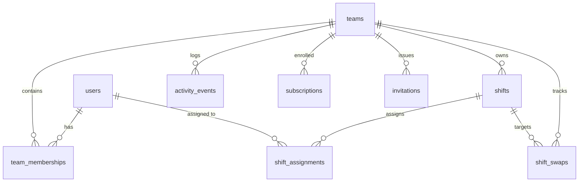
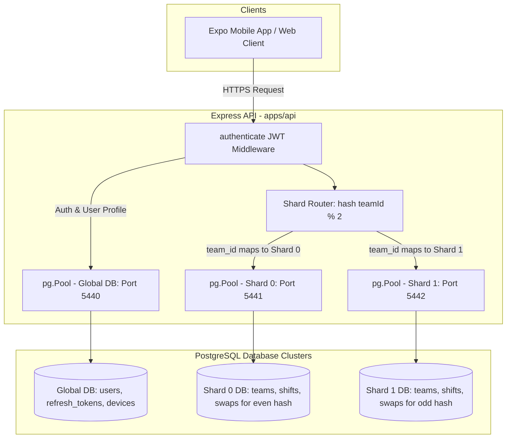

# Database Architecture & Sharding Strategy — Rota

This document analyzes the database architecture of the Rota application, detailing the current implemented single-database multi-tenant structure, the natural shard key, tenant routing and isolation patterns, and the explicit status and architectural blueprint for the two-database PostgreSQL sharding simulation.

---

## 1. Executive Summary & Implementation Status

> [!IMPORTANT]
> **Implementation Status: The two-PostgreSQL-database sharding simulation is NOT IMPLEMENTED.**
> 
> As documented in [`docs/IMPLEMENTATION-STATUS.md`](file:///c:/Users/HP/Desktop/rota%20project/docs/IMPLEMENTATION-STATUS.md#L121) (*"PostgreSQL sharding simulation: Not started (Needs design decision (logical shards by team_id))"*), the codebase currently operates against a **single PostgreSQL 15 database instance**. There is no multi-database connection pool, database proxy, or simulated two-database routing layer in the repository.

Instead, Rota implements **logical multi-tenancy** enforced at the application and schema layers via `team_id` foreign keys, composite indexes, and role-based middleware.

This document outlines both the **verifiable current architecture** and the **technical specification for the required two-database sharding simulation**.

---

## 2. Current Implemented Database Architecture

### 2.1 Topology & Infrastructure
In the current repository:
- **Docker Compose** ([`infrastructure/docker-compose.yml`](file:///c:/Users/HP/Desktop/rota%20project/infrastructure/docker-compose.yml)): Defines a single PostgreSQL service (`postgres:15-alpine`) bound to host port **5440** (database: `rota`, user: `postgres`).
- **Connection Management** ([`apps/api/src/db.ts`](file:///c:/Users/HP/Desktop/rota%20project/apps/api/src/db.ts)): Uses a single `pg.Pool` instance connected to `process.env.DATABASE_URL`:
  ```typescript
  export const pool = new Pool({
    connectionString: env.DATABASE_URL,
  });
  ```
- **Migration Pipeline** ([`apps/api/src/migrate.ts`](file:///c:/Users/HP/Desktop/rota%20project/apps/api/src/migrate.ts)): Executes SQL migration files `001` through `006` sequentially against this single database.

### 2.2 Logical Multi-Tenancy Data Model
All tenant-scoped entities contain a mandatory `team_id UUID REFERENCES teams(id) ON DELETE CASCADE`:



1. **Global Tables (Non-Tenant Scoped)**:
   - `users`: User identity, email, password hash.
   - `refresh_tokens`: User session families, token rotation hashes.
   - `devices`: User push device tokens for Expo push notifications.
   - `device_preferences`: Notification preference toggles per user.
2. **Tenant-Scoped Tables (`team_id` Partitioned)**:
   - `teams`, `team_memberships`, `invitations`, `invitation_attempts`.
   - `shifts`, `shift_assignments`, `shift_swaps`, `activity_events`.
   - `plans`, `subscriptions`, `subscription_changes`, `payments`, `invoices`.

---

## 3. Shard Key Selection & Analysis

### 3.1 The Chosen Shard Key: `team_id`
The natural and optimal shard key for Rota is **`team_id` (UUID)**.

### 3.2 Evaluation Criteria & Domain Fit

| Evaluation Criteria | Fit with `team_id` | Rationale & Codebase Evidence |
|---|---|---|
| **Query Locality** | **99%+ Intra-Team** | Almost all high-frequency endpoints (`/teams/:teamId/shifts`, `/teams/:teamId/swaps`, `/teams/:teamId/activity`, `/teams/:teamId/subscription`) operate exclusively within a single team's boundary. |
| **Transaction Boundaries** | **Zero Cross-Shard TXs for Core Workflows** | Shift creation, multi-assignee assignment, swap approval, and shift deletion operate exclusively on records belonging to the same `team_id`. No distributed transactions or two-phase commits (2PC) are required for core operations. |
| **Data Volume Distribution** | **Even Across Teams** | In small business scheduling (restaurants, medical clinics, retail shops), team sizes typically range from 5 to 50 employees. Storage footprint per team is predictable and horizontally scalable. |
| **Tenant Isolation** | **High Security Boundary** | Physically isolating data by `team_id` aligns directly with organizational isolation requirements, preventing data leaks across competing businesses. |

---

## 4. Tenant Isolation & Routing Mechanism

### 4.1 Implemented Logical Isolation
In the current single-database implementation, tenant isolation is enforced at two layers:

1. **Routing & Authorization Middleware (`requireRole`)**:
   Implementation: [`apps/api/src/middleware/role.ts`](file:///c:/Users/HP/Desktop/rota%20project/apps/api/src/middleware/role.ts)
   - Inspects `req.params.teamId`.
   - Validates that `teamId` is a valid UUID (`/^[0-9a-f]{8}-[0-9a-f]{4}-[0-9a-f]{4}-[0-9a-f]{4}-[0-9a-f]{12}$/i`); returns HTTP 400 `INVALID_PARAMS` if malformed.
   - Queries `team_memberships` for `(team_id, user_id)`.
   - **404 Not Found**: If the user is not a member of the team, the API returns 404 rather than 403, preventing unauthorized callers from discovering whether a team exists.
   - **403 Forbidden**: If the user is a member but lacks the required role (`OWNER`, `MANAGER`, `STAFF`).
2. **Parameterized SQL Query Scoping**:
   All database queries in route handlers include `WHERE team_id = $1` with parameterized arguments, preventing SQL injection and cross-tenant data leakage:
   ```sql
   SELECT * FROM shifts WHERE team_id = $1 AND id = $2;
   ```
3. **Composite Index Optimization**:
   As verified in [`docs/PAGINATION.md`](file:///c:/Users/HP/Desktop/rota%20project/docs/PAGINATION.md) and [`apps/api/migrations/003_shifts_swaps_activity.sql`](file:///c:/Users/HP/Desktop/rota%20project/apps/api/migrations/003_shifts_swaps_activity.sql):
   - `idx_shifts_team_starts`: `shifts(team_id, starts_at, id)`
   - `idx_activity_events_team_created`: `activity_events(team_id, created_at DESC, id DESC)`
   - `idx_activity_events_team_type_created`: `activity_events(team_id, type, created_at DESC, id DESC)`
   These composite indexes ensure that queries filter immediately by `team_id` before performing keyset pagination.

---

## 5. Architectural Blueprint for Two-Database Sharding Simulation

To satisfy the graduation requirement for a **two-PostgreSQL-database sharding simulation**, the following architecture must be implemented.

### 5.1 Proposed Infrastructure Topology



1. **Docker Compose Services** (`infrastructure/docker-compose.yml` update):
   - `postgres_global` (Port 5440): Hosts global tables (`users`, `refresh_tokens`, `devices`, `device_preferences`).
   - `postgres_shard_0` (Port 5441): Hosts tenant tables for shard 0.
   - `postgres_shard_1` (Port 5442): Hosts tenant tables for shard 1.

### 5.2 Deterministic Shard Hashing Algorithm
A deterministic hashing function maps each UUID `team_id` to either Shard 0 or Shard 1:

```typescript
import { createHash } from 'crypto';

export function getShardId(teamId: string): number {
  // Deterministic 32-bit integer hash from teamId UUID
  const hash = createHash('md5').update(teamId).digest('hex');
  const numericVal = parseInt(hash.substring(0, 8), 16);
  return numericVal % 2; // Returns 0 or 1
}
```

### 5.3 Shard Connection Router Middleware
A custom database routing layer resolves the connection pool based on route parameters:

```typescript
import { Request, Response, NextFunction } from 'express';
import { Pool, PoolClient } from 'pg';

export interface ShardedRequest extends Request {
  shardId?: number;
  dbPool?: Pool;
}

export function shardRoutingMiddleware(req: ShardedRequest, res: Response, next: NextFunction) {
  const teamId = req.params.teamId;
  if (!teamId) {
    req.dbPool = globalPool;
    return next();
  }

  const shardId = getShardId(teamId);
  req.shardId = shardId;
  req.dbPool = shardId === 0 ? shardPool0 : shardPool1;
  next();
}
```

---

## 6. Implications for Large Teams & Cross-Shard Queries

Sharding by `team_id` introduces specific operational and architectural constraints that must be handled when scaling.

### 6.1 Large Teams ("Hot Shard" Problem)
- **Constraint**: Sharding by `team_id` distributes *teams*, not individual employees within a team.
- **Impact**: If a massive enterprise customer with 5,000 active staff and 500,000 shifts is provisioned, that entire workload concentrates on a single PostgreSQL shard.
- **Mitigation Strategy**:
  1. **Capacity Gating**: Rota's Phase 4 billing system already enforces seat limits per plan (`FREE` max 5, `STARTER` max 15, `GROWTH` max 50, `SCALE` max 200). Enterprise tiers exceeding 200 seats would require dedicated isolated shards.
  2. **Secondary Partitioning**: For ultra-large teams, table partitioning by `starts_at` (e.g. monthly PostgreSQL declarative range partitions) can be applied within the shard.

### 6.2 Global Entities & Cross-Shard Queries

| Query / Flow | Cross-Shard Nature | Architectural Solution |
|---|---|---|
| **User Login (`POST /auth/login`)** | Global | Authenticates against `users` table on the Global Database before any team context is known. |
| **Token Refresh (`POST /auth/refresh`)** | Global | Validates bcrypt token hashes against `refresh_tokens` on the Global Database. |
| **List User's Teams (`GET /teams`)** | Scatter-Gather or Lookup Index | A single user can be an owner or member in multiple teams across both Shard 0 and Shard 1.<br/>**Solution A (Scatter-Gather)**: Query Shard 0 and Shard 1 concurrently via `Promise.all([pool0.query(...), pool1.query(...)])` and merge/sort in Express memory.<br/>**Solution B (Global Membership Index)**: Maintain a lightweight index table `user_teams(user_id, team_id, shard_id)` on the Global Database to resolve team IDs in a single query. |
| **Team Invitations (`POST /invitations/accept`)** | Cross-Database Transaction | The accepting user exists in the Global Database, while `team_memberships` and `invitations` live on the team's shard.<br/>**Solution**: Two-step idempotent write: verify global user identity, then acquire a client on the target team shard to execute the membership insertion and invitation nullification in a local transaction. |
| **Shift Swaps** | **Intra-Shard Only** | In Rota's domain, shift swaps can only occur between verified members of the same team. Cross-team swaps are disallowed by design. Therefore, swap approval **never requires a distributed transaction**. |
| **Push Notifications (`services/notifications.ts`)** | Cross-Shard Event Forwarding | When a shift or swap is written on a shard, recipient user IDs are extracted. The push notification service queries device tokens from `devices` on the Global Database and forwards them to the Expo Push API. |

---

## 7. Audit Conclusion & Gaps Summary

1. **Current Reality**: Rota possesses a production-tested, single-database PostgreSQL 15 multi-tenant architecture with strict logical isolation enforced via `requireRole` and parameterized `WHERE team_id = $1` queries.
2. **Simulation Gap**: The physical two-PostgreSQL-database sharding simulation has **not been built** in this repository.
3. **Readiness for Implementation**: The codebase's strict adherence to `team_id` parameterization and absence of cross-team joins makes migrating to the proposed two-shard architecture straightforward whenever instructed.
