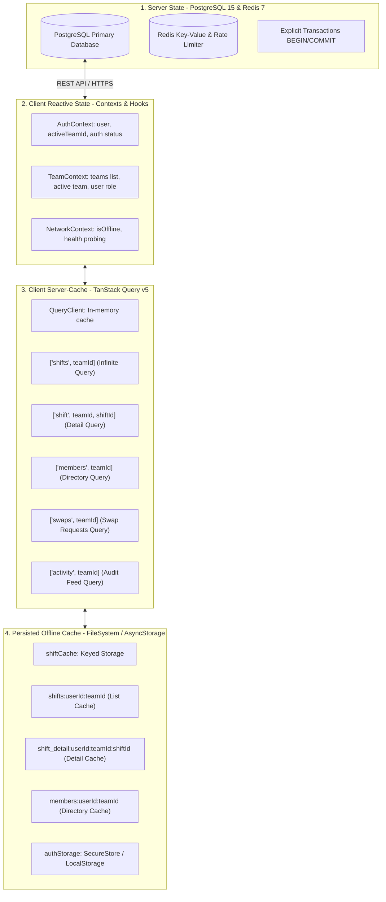

# State Management Architecture — Rota

This document provides a comprehensive analysis of the state management architecture in Rota, spanning the Express/PostgreSQL/Redis backend and the Expo React Native client application. All sections are grounded strictly in verifiable codebase implementations.

---

## 1. Architectural Overview & State Taxonomy

Rota splits application state across four distinct architectural tiers to ensure strict multi-tenant isolation, ACID consistency for business-critical scheduling workflows, and a responsive mobile experience under spotty or offline network conditions.



| State Category | Storage Location | Management Mechanism | Scope & Lifetime | Key File References |
|---|---|---|---|---|
| **Canonical Server State** | PostgreSQL 15 | SQL tables with explicit transactions (`BEGIN`/`COMMIT`/`ROLLBACK`) | Persistent, durable across all tenants | `apps/api/src/db.ts`, `apps/api/src/routes/*` |
| **Ephemeral Server State** | Redis 7 & Process Memory | Redis keys (`rl:devices:*`), Express memory rate limiters | Windowed TTL (15 min) | `apps/api/src/redis.ts`, `apps/api/src/middleware/rate-limit.ts` |
| **Client Session & Identity** | SecureStore / Memory | React Context (`AuthContext`) + `authStorage` | Session lifetime; persisted across restarts | `apps/mobile/src/context/AuthContext.tsx`, `apps/mobile/src/storage/authStorage.ts` |
| **Client Organization Context** | React State / SecureStore | React Context (`TeamContext`) | Persisted selected team ID | `apps/mobile/src/context/TeamContext.tsx` |
| **Client Network State** | React State / Health Probing | React Context (`NetworkContext`) + `ApiClient` events | Real-time device connectivity | `apps/mobile/src/context/NetworkContext.tsx`, `apps/mobile/src/api/client.ts` |
| **Cached Server State** | Client In-Memory RAM | TanStack React Query (`useQuery`, `useInfiniteQuery`) | Garbage collected, window focus/reconnect refetched | `apps/mobile/src/query/queryClient.ts`, `apps/mobile/app/(tabs)/*` |
| **Offline Cache** | Device Storage (FileSystem) | Custom disk serializer (`shiftCache.ts` + `asyncStorage.ts`) | Persisted per `userId:teamId`; pruned on edit/logout | `apps/mobile/src/storage/shiftCache.ts`, `apps/mobile/src/storage/asyncStorage.ts` |

---

## 2. Server-Side State & Concurrency

The backend API (`apps/api`) adheres to stateless application server design principles, delegating all state to PostgreSQL and Redis.

### 2.1 Canonical State & Transactional Guarantees
Database access is handled through a connection pool configured in [`apps/api/src/db.ts`](file:///c:/Users/HP/Desktop/rota%20project/apps/api/src/db.ts):
```typescript
export const pool = new Pool({
  connectionString: env.DATABASE_URL,
});
```

All state-modifying operations involving multiple tables are strictly enclosed within explicit transactions using `BEGIN`, `COMMIT`, and `ROLLBACK` blocks with guaranteed client cleanup in `finally` blocks:

1. **Team Creation & Owner Provisioning** ([`apps/api/src/routes/teams.ts`](file:///c:/Users/HP/Desktop/rota%20project/apps/api/src/routes/teams.ts)):
   - Inserts the `teams` record.
   - Inserts the creator as `OWNER` in `team_memberships`.
   - Provisions a default `FREE` tier in `subscriptions` within the identical transaction.
2. **Invitation Acceptance & Activity Logging** ([`apps/api/src/routes/invitations.ts`](file:///c:/Users/HP/Desktop/rota%20project/apps/api/src/routes/invitations.ts)):
   - Verifies the 6-digit numeric code hash (`hashInvitationCode`).
   - Marks `accepted_at = NOW()` on the invitation.
   - Inserts a new membership row in `team_memberships`.
   - Emits a transactional `MEMBER_JOINED` event into `activity_events`.
3. **Shift Deletion & Swap Cleanup** ([`apps/api/src/routes/shifts.ts`](file:///c:/Users/HP/Desktop/rota%20project/apps/api/src/routes/shifts.ts)):
   - Cancels all pending shift swaps targeting the shift (`UPDATE shift_swaps SET status = 'CANCELLED'`).
   - Removes assignments in `shift_assignments`.
   - Deletes the shift in `shifts`.
   - Appends a `SHIFT_DELETED` audit row in `activity_events`.
4. **Shift Swap Execution** ([`apps/api/src/routes/swaps.ts`](file:///c:/Users/HP/Desktop/rota%20project/apps/api/src/routes/swaps.ts)):
   - Re-verifies membership and current shift assignment status within the transaction.
   - Atomically transfers shift assignment from `requested_by` to `offered_to`.
   - Updates `shift_swaps.status = 'APPROVED'`.
   - Records `SWAP_APPROVED` in `activity_events`.

### 2.2 Billing Lifecycle & Lazy Status Transitions
Subscription state management ([`apps/api/src/billing/service.ts`](file:///c:/Users/HP/Desktop/rota%20project/apps/api/src/billing/service.ts)) employs **lazy state evaluation**:
- Instead of relying on brittle background cron daemons to expire subscriptions, whenever a team's subscription is retrieved (`getSubscription`), `transitionStatus(subscription, now)` evaluates whether `current_period_end` has elapsed.
- If elapsed without renewal, it automatically transitions from `ACTIVE` to `PAST_DUE` (granting a grace period defined by `SUBSCRIPTION_GRACE_DAYS`), and subsequently to `EXPIRED`.
- Shifts and invitation routes enforce gates based on this live-calculated status (`assertSubscriptionActive` and `assertCanGrow`).

---

## 3. Client State Management

The mobile application (`apps/mobile`) uses React Context for global app coordination and TanStack React Query for asynchronous server state.

### 3.1 Authentication & Session State (`AuthContext`)
Implementation: [`apps/mobile/src/context/AuthContext.tsx`](file:///c:/Users/HP/Desktop/rota%20project/apps/mobile/src/context/AuthContext.tsx)
- **State variables**: `user: User | null`, `activeTeamId: string | null`, `loading: boolean`.
- **Token Persistence**: Managed through [`apps/mobile/src/storage/authStorage.ts`](file:///c:/Users/HP/Desktop/rota%20project/apps/mobile/src/storage/authStorage.ts), using `expo-secure-store` on native platforms (iOS Keychain / Android Keystore) and `localStorage` on web browsers.
- **Token Refresh Lifecycle**:
  - Automatically invoked on app initialization (`refreshAuth`).
  - Single-flight refresh coordination in [`apps/mobile/src/api/client.ts`](file:///c:/Users/HP/Desktop/rota%20project/apps/mobile/src/api/client.ts): when an API request encounters HTTP 401, `ApiClient` buffers concurrent failed requests, requests a refreshed JWT via `POST /auth/refresh`, updates storage, and transparently retries the pending operations.
- **Logout Cleansing**:
  - Unregisters device push tokens via `unregisterCurrentDevice()`.
  - Clears all cached shifts and member details for the logged-out user via `clearUserCache(user.id)`.
  - Clears TanStack Query memory cache via `queryClient.clear()`.
  - Invalidates the refresh token on the server (`POST /auth/logout`).
  - Purges tokens from `authStorage`.

### 3.2 Active Team & Role Context (`TeamContext`)
Implementation: [`apps/mobile/src/context/TeamContext.tsx`](file:///c:/Users/HP/Desktop/rota%20project/apps/mobile/src/context/TeamContext.tsx)
- Manages the user's available team list (`teams: Team[]`), the currently selected team (`team: Team | null`), and the user's role within that active team (`role: TeamRole | null`: `'OWNER' | 'MANAGER' | 'STAFF'`).
- The active team selection is persisted under key `'selectedTeamId'` in `authStorage`.
- When switching teams, `selectTeam(nextId)` updates persisted storage, resets local role state, and re-triggers team membership resolution.

### 3.3 Connectivity State & Auto-Reconnection (`NetworkContext`)
Implementation: [`apps/mobile/src/context/NetworkContext.tsx`](file:///c:/Users/HP/Desktop/rota%20project/apps/mobile/src/context/NetworkContext.tsx)
- Exposes `isOffline: boolean` and `checkConnection: () => Promise<boolean>`.
- Subscribes directly to `apiClient.onNetworkStatusChange` in [`apps/mobile/src/api/client.ts`](file:///c:/Users/HP/Desktop/rota%20project/apps/mobile/src/api/client.ts) to detect network failure flags from fetch errors immediately.
- When offline, engages a 5-second interval heartbeat calling `apiClient.getHealth()`.
- **Automatic Reconnection Invalidation**: When connectivity is restored (`wasOffline.current && !isOffline`), it triggers:
  ```typescript
  queryClient.invalidateQueries({ queryKey: ['shifts'] });
  queryClient.invalidateQueries({ queryKey: ['shift'] });
  queryClient.invalidateQueries({ queryKey: ['members'] });
  ```

---

## 4. TanStack Query Server Caching & Invalidation

Server state synchronization is driven by `@tanstack/react-query` v5 (`queryClient` configured in [`apps/mobile/src/query/queryClient.ts`](file:///c:/Users/HP/Desktop/rota%20project/apps/mobile/src/query/queryClient.ts)).

### 4.1 Query Keys & Cache Structures

| Query Key Pattern | Query Type | Used In | Purpose & Data Structure |
|---|---|---|---|
| `['shifts', teamId]` | `useInfiniteQuery` | [`app/(tabs)/index.tsx`](file:///c:/Users/HP/Desktop/rota%20project/apps/mobile/app/%28tabs%29/index.tsx) | Paginated shift pages (`{ pages: [{ items: Shift[], nextCursor?: string }] }`) |
| `['shift', teamId, shiftId]` | `useQuery` | [`app/shifts/[shiftId].tsx`](file:///c:/Users/HP/Desktop/rota%20project/apps/mobile/app/shifts/%5BshiftId%5D.tsx) | Single shift entity including assignments and member metadata |
| `['members', teamId]` | `useQuery` | [`app/shifts/[shiftId].tsx`](file:///c:/Users/HP/Desktop/rota%20project/apps/mobile/app/shifts/%5BshiftId%5D.tsx) | Complete list of team members for assignee assignment and swap offers |
| `['swaps', teamId]` | `useInfiniteQuery` | [`app/(tabs)/swaps.tsx`](file:///c:/Users/HP/Desktop/rota%20project/apps/mobile/app/%28tabs%29/swaps.tsx) | Paginated shift swap requests filtered by role permissions |
| `['activity', teamId]` | `useInfiniteQuery` | [`app/(tabs)/activity.tsx`](file:///c:/Users/HP/Desktop/rota%20project/apps/mobile/app/%28tabs%29/activity.tsx) | Paginated audit events feed for the team |

### 4.2 Retry Policy Under Offline Conditions
To prevent request spam and cascading UI errors when disconnected, all queries configure conditional retry logic:
```typescript
retry: (failureCount) => (isOffline ? false : failureCount < 1)
```
When `isOffline` is true, queries fail immediately and surface cached data without retrying.

### 4.3 Cache Invalidation Patterns & Mutation Side-Effects

TanStack Query invalidations are strictly scoped to the active team:

1. **Shift Assignment & Modification** ([`apps/mobile/app/shifts/[shiftId].tsx`](file:///c:/Users/HP/Desktop/rota%20project/apps/mobile/app/shifts/%5BshiftId%5D.tsx)):
   ```typescript
   const invalidateAll = () => {
     queryClient.invalidateQueries({ queryKey: ['shifts', teamId] });
     queryClient.invalidateQueries({ queryKey: ['activity', teamId] });
     queryClient.invalidateQueries({ queryKey: ['swaps', teamId] });
     queryClient.invalidateQueries({ queryKey: ['shift', teamId, shiftId] });
   };
   ```
2. **Shift Deletion — Query Eviction Preceding Invalidation**:
   In [`apps/mobile/app/shifts/[shiftId].tsx`](file:///c:/Users/HP/Desktop/rota%20project/apps/mobile/app/shifts/%5BshiftId%5D.tsx#L153-L170), when a shift is deleted, standard invalidation would cause TanStack Query to immediately refetch `['shift', teamId, shiftId]`, yielding an HTTP 404 and triggering a false error alert as the screen unmounts. To prevent this race condition:
   ```typescript
   // 1. Immediately remove this shift query from the cache so it will not refetch
   queryClient.removeQueries({ queryKey: ['shift', teamId, shiftId] });
   // 2. Invalidate lists so they refresh
   queryClient.invalidateQueries({ queryKey: ['shifts', teamId] });
   queryClient.invalidateQueries({ queryKey: ['activity', teamId] });
   queryClient.invalidateQueries({ queryKey: ['swaps', teamId] });
   // 3. Purge from persistent offline cache
   removeCachedShiftDetail(user.id, teamId, shiftId);
   // 4. Safely navigate away
   router.back();
   ```
3. **Swap Mutations (Approve / Reject / Cancel)** ([`apps/mobile/app/(tabs)/swaps.tsx`](file:///c:/Users/HP/Desktop/rota%20project/apps/mobile/app/%28tabs%29/swaps.tsx#L57-L62)):
   Invalidates `['swaps', teamId]`, `['shifts', teamId]`, `['shift', teamId]`, and `['activity', teamId]` to reflect reassigned workers immediately across both the calendar and swap ledger.

---

## 5. Persisted Offline State & Tenant Isolation

Offline capability is implemented via [`apps/mobile/src/storage/shiftCache.ts`](file:///c:/Users/HP/Desktop/rota%20project/apps/mobile/src/storage/shiftCache.ts), using an underlying storage engine ([`apps/mobile/src/storage/asyncStorage.ts`](file:///c:/Users/HP/Desktop/rota%20project/apps/mobile/src/storage/asyncStorage.ts)) that delegates to native FileSystem storage or browser AsyncStorage.

### 5.1 Storage Key Partitioning & Schemas
Every cache key explicitly isolates data across both **User ID** and **Team ID**:
- **Shift List**: `shifts:${userId}:${teamId}` (`makeShiftsKey`)
- **Shift Detail**: `shift_detail:${userId}:${teamId}:${shiftId}` (`makeShiftDetailKey`)
- **Team Members**: `members:${userId}:${teamId}` (`makeMembersKey`)

```typescript
export interface CachedShiftsData {
  userId: string;
  teamId: string;
  cachedAt: number;
  items: Shift[];
  nextCursor?: string;
}
```

### 5.2 Read-Through Caching & Pre-Caching
- **List-to-Detail Pre-caching**: When shifts are fetched over the network in [`apps/mobile/app/(tabs)/index.tsx`](file:///c:/Users/HP/Desktop/rota%20project/apps/mobile/app/%28tabs%29/index.tsx#L58-L60), `saveCachedShifts` persists the list and concurrently saves each individual shift entity into `shift_detail:${userId}:${teamId}:${shift.id}`. This guarantees that tapping into any shift while offline immediately renders full details.
- **Cache Pre-population**: On screen mount, if TanStack Query has no in-memory data, `getCachedShifts` reads from storage and seeds the QueryClient via `queryClient.setQueryData(['shifts', teamId], ...)`, providing instant rendering before network responses arrive.
- **Offline Fallback**: If the network is unavailable or queries fail, `items = queryItems.length > 0 ? queryItems : (cachedData?.items ?? [])` ensures seamless display.

### 5.3 Cross-Tenant Isolation & Logout Sanitization
In multi-tenant or shared-device scenarios, stale cached data must never leak across different accounts:
1. **Verification on Read**: `getCachedShifts` and `getCachedShiftDetail` deserialize payloads and verify `parsed.userId === userId && parsed.teamId === teamId`. Any mismatch results in a discarded cache entry.
2. **User Cache Eviction**: On logout ([`apps/mobile/src/context/AuthContext.tsx`](file:///c:/Users/HP/Desktop/rota%20project/apps/mobile/src/context/AuthContext.tsx#L63)), `clearUserCache(userId)` iterates over storage keys and strips all keys matching `:${userId}:`. This behavior is validated by the test suite in [`apps/api/__tests__/cacheIsolation.test.ts`](file:///c:/Users/HP/Desktop/rota%20project/apps/api/__tests__/cacheIsolation.test.ts).

---

## 6. Optimistic Updates, Mutation Guarding & Rollbacks

### 6.1 Architectural Decision: Pessimistic Mutation with Offline Guarding
In business scheduling systems (hospitals, restaurants, retail), shift modifications have strict invariants:
- Staff cannot be double-booked across overlapping shifts.
- Swaps require atomic mutual agreements and must not operate on cancelled shifts.
- Team membership permissions can change dynamically.

**Trade-off Evaluation**: Allowing full offline optimistic write queues (e.g. queuing shift edits or swap approvals locally while disconnected) creates severe reconciliation hazards: when reconnected, an offline approval could conflict with a shift deleted by an owner, or approve an already-reassigned shift, creating corrupted schedules.

**Implementation Strategy**:
1. **Offline Mutation Guarding**: All write mutations proactively check `isOffline` via `guardOffline(actionName)` before dispatching. If offline, the mutation throws immediately, and an alert informs the user that writes require an active connection.
2. **UI Pending Affordances**: Buttons and detail views display loading indicators (`isDeleting`, `mutation.isPending`) and disable duplicate submissions.
3. **Rollback & Recovery**: Because mutations are pessimistic, if a server request fails (e.g., HTTP 409 `SWAP_NOT_PENDING` or HTTP 400 `INVALID_ASSIGNEE`), the server rollback occurs automatically within the PostgreSQL transaction, and the client displays the server error message while preserving the user's active form inputs for correction.

### 6.2 Mutation Response Parsing Contract
In Express, successful delete and void mutations often respond with `204 No Content` or `{ success: true }` without an inner `data` payload.

As resolved in [`apps/mobile/src/api/ensure.ts`](file:///c:/Users/HP/Desktop/rota%20project/apps/mobile/src/api/ensure.ts) and verified in [`apps/api/__tests__/mutationResponseContract.test.ts`](file:///c:/Users/HP/Desktop/rota%20project/apps/api/__tests__/mutationResponseContract.test.ts):
- `dataOrThrow<T>(res)`: Used for queries and read endpoints returning payloads; throws if `res.data` is missing.
- `ensureSuccess(res)`: Used for void mutations (delete shift, approve swap, cancel swap); checks `res.success === true` without requiring a `data` property, preventing false "Request failed" alerts.
- `ApiClient` in [`apps/mobile/src/api/client.ts`](file:///c:/Users/HP/Desktop/rota%20project/apps/mobile/src/api/client.ts) safely parses HTTP 204/205 responses directly into `{ success: true }`.

---

## 7. Implementation Trade-offs Summary

| Architectural Area | Implemented Pattern | Alternative Considered | Trade-off Rationale |
|---|---|---|---|
| **Offline Writes** | Pessimistic mutation blocking (`guardOffline`) | Offline write queues with background sync | Prevents catastrophic schedule conflicts, double-booking, and phantom swaps in a multi-user collaborative rota. |
| **Offline Reads** | Read-through persistent file cache (`shiftCache.ts`) | Pure in-memory cache | Allows staff to view their shifts and coworker contact info without cell connectivity. |
| **Cache Keying** | Strict composite keys (`shifts:userId:teamId`) | Single global key `shifts:teamId` | Prevents cross-account data leaks when multiple employees share a physical device or tablet. |
| **Cache Invalidation** | Selective query eviction (`removeQueries`) on delete | Blanket invalidation (`invalidateQueries`) | Avoids race conditions where unmounting deleted screens refetch and display false 404 alerts. |
| **Subscription Status** | Lazy evaluation (`transitionStatus`) on query | Background cron daemon | Eliminates daemon infrastructure failure points; guarantees zero stale reads upon query arrival. |
